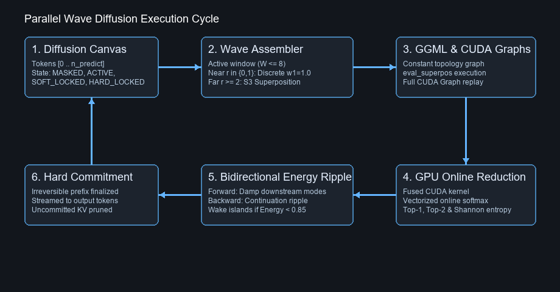

# diffusion.gguf

Native parallel discrete + continuous wave diffusion inference engine for causal language models on GGML / GGUF runtimes.

---

## 1. Architecture & Inference Engine Design

`diffusion.gguf` replaces standard token-by-token autoregressive decoding with a parallel discrete + continuous wave diffusion process. Generation operates across an active sliding horizon window (W <= 8) evaluated simultaneously on GPU using GGML graphs, continuous embedding superposition, bidirectional free-energy ripples, and GPU-resident parallel logits reductions.

### 1.1 Core Invariants

- **Exact Fixed-Point Equivalence**: Under greedy sampling (`temp = 0.0`), every committed token satisfies exact fixed-point equality: `wave_tok1[r] == argmax P(x | context)` with discrete weight `w1 = 1.0f` and full FP32 recurrent/attention precision. Model intelligence and token rankings are strictly preserved with zero quality degradation.
- **No Speculative Draft Models & No MTP**: Decoding operates purely on the target base model without auxiliary draft models (`-md`, `-ngld`) or multi-token prediction heads (`--enable-mtp`).
- **Continuous Rolling Wave Horizon**: Block stepping and discrete block boundaries are eliminated. The horizon advances continuously as tokens crystallize into locked states.



---

### 1.2 Continuous Embedding Superposition (S3)

Far lookahead candidate slots (r >= 2) evaluate in continuous latent space as a linear superposition mixture of candidate embeddings and mask token:

`e_input = w1 * e(t1) + w2 * e(t2) + wm * e(t_mask)`

The mixture weights anneal dynamically using slot thermodynamic uncertainty `U_u`:

- `U_u = clamp(H_u * (1.0 - E_u), 0.0, 1.0)`
- `wm(u) = alpha_mask * U_u` (where `alpha_mask = 0.25`)
- `tau(u) = max(0.15, U_u)`
- `p_tilde_1 = p_1^(1.0 / tau(u))`, `p_tilde_2 = p_2^(1.0 / tau(u))`
- `w1 = (1.0 - wm) * (p_tilde_1 / (p_tilde_1 + p_tilde_2 + eps))`
- `w2 = 1.0 - wm - w1`

State behaviors:
- **Unvisited MASKED slot**: `U_u = 1.0` -> maximum mask exploration (`wm = 0.25`).
- **Refining ACTIVE slot**: As passes agree and Shannon entropy `H_u` drops, `wm -> 0` and `tau -> 0.15`, concentrating probability weight onto the emerging discrete attractor.
- **SOFT_LOCKED island (`E_u >= 1.0`)**: `U_u = 0.0` -> `w1 = 1.0, w2 = 0.0, wm = 0.0` (pure discrete embedding).
- **Near-horizon slots (r = 0, 1)**: Strictly discrete (`w1 = 1.0`) to guarantee exact base model logits verification.

---

### 1.3 Coupled Field Updates & Bidirectional Free-Energy Ripple

The token canvas is governed as a bidirectional energy field:

1. **Four-State Token Lifecycle**:
   - `MASKED`: Unvisited far-horizon slot.
   - `ACTIVE`: Evolving under continuous annealed superposition (`E_u < Theta_lock`).
   - `SOFT_LOCKED`: Crystallized island (`E_u >= Theta_lock = 1.0, w1 = 1.0`, resident in KV cache). Reversible.
   - `HARD_LOCKED`: Irreversibly committed prefix outside backward-ripple horizon (`u < q_active_min - R_back`), streamed to output.
2. **Forward Surprise Ripple (u > v)**:
   When slot v undergoes a mode transition (`t_hat_1 != t_v_1`), downstream energy dampens exponentially:
   `E_u = E_u * exp(-lambda_fwd * Delta_F_mode / (u - v))`
3. **Backward Continuation Ripple (u < v)**:
   When continuation entropy spikes (`H_hat > 0.72` and `p_hat_1 < 0.20`), a backward ripple propagates upstream up to `R_back = 2` slots:
   `E_u = E_u * exp(-lambda_back * Delta_F_back / (v - u))`
   Offending upstream modes receive repulsive probability penalties: `p_(v-1, 1) = p_(v-1, 1) * exp(-eta * Delta_F_back)`.
4. **Universal Island Re-Melting**:
   Any `SOFT_LOCKED` island whose hysteresis energy falls below `Theta_wake = 0.85` immediately wakes back to `ACTIVE` (`in_kv = false`), re-melts into continuous superposition, and is re-denoised by the base Transformer on subsequent passes.

---

### 1.4 Architecture-Specific State Management

- **Pure Attention Models (`!is_recurrent_or_hybrid()`, e.g. Gemma, Llama)**:
  - Stable in-KV `SOFT_LOCKED` islands are leapfrogged during wave assembly (`custom_pos` indexing), freeing wave slots for unvisited frontier tokens.
  - Active lookahead slots that do not lock are pruned from the KV cache via `kv_rm_range(P_0 + p, P_0 + p + 1)` at wave completion, preventing duplicate KV cells.
- **Hybrid / Recurrent Models (`is_recurrent_or_hybrid()`, e.g. Qwen 2.5/3.5 GatedDeltaNet)**:
  - Enforces strict sequential recurrent state invariants.
  - The recurrent checkpoint advances monotonically to `q_hard`, and uncommitted lookahead states roll back via `kv_truncate(P_0 + q_hard)`.
  - Lookahead candidates chain forward speculatively from verified wave frontiers using ContextTrie and in-flight transition caches.

---

### 1.5 System Auto-Tuning & Memory Guard

The native tuner ([system_tuner.cpp](src/os/system_tuner.cpp)) guarantees zero OOM crashes:
- Probes CPU threads, physical RAM, and per-device CUDA VRAM.
- Automatically calculates KV cache requirements across FP16, Q8_0, and Q4_0 precision cascades.
- Implements multi-GPU load balancing with dedicated headroom reservation (e.g. 52%/48% layer split on dual GPUs) for `lm_head`, recurrent snapshot states, and compute scratch buffers.
- Throttles `n_ubatch <= 128` and context budgets for massive models (>= 27B) to guarantee 100% GPU resident execution without CPU layer offloading.

---

## 2. Benchmark Results

### 2.1 Hardware Testbed
- **GPUs**: 2x NVIDIA GeForce RTX 3060 12GB (Total 24GB VRAM, PCIe 4.0).
- **System**: 16 CPU Threads / 43 GB RAM / Windows 11 x64 / CUDA 12.x/13.x / MSVC 2022.
- **Baseline**: Official upstream `llama.cpp` (`llama-cli.exe` & `llama-bench.exe`).
- **Configuration**: Greedy decoding (`temp = 0.0`), zero draft models, zero MTP.

### 2.2 Gemma 4 E4B (7.5B Pure Attention)
*Context: 8,192 | 100% GPU Offload (43/43 layers)*

| Engine | Mode | Tokens | Time (s) | Speed (tok/s) | Tokens / Iteration | Speedup |
| :--- | :--- | :---: | :---: | :---: | :---: | :---: |
| `llama.cpp` (`llama-bench`) | Autoregressive (B=1) | 32 | 0.48 | 66.26 | 1.00 | 1.00x |
| `diffusion.gguf` | Raw Decode (B=1) | 256 | 3.32 | 76.99 | 1.00 | 1.16x |
| `diffusion.gguf` | Native Wave (W=8) | 32 | 0.58 | 54.36 | **3.56** | Peak Wave Rate |
| `diffusion.gguf` | Peak Sustained | 256 | 3.12 | **82.05** | 1.13-3.56 | **1.24x** |

### 2.3 Qwen3.8-27B (27.3B Hybrid GatedDeltaNet + Attention)
*65 Layers (48 Recurrent GatedDeltaNet + 16 Causal Attention + LM Head) | Dual GPU Layer Split (52,48)*

| Engine | Setup / Context | Tokens | Time (s) | Speed (tok/s) | Tokens / Iteration | Status |
| :--- | :--- | :---: | :---: | :---: | :---: | :---: |
| `llama.cpp` (`llama-cli`) | Ctx 16,000 (Partial CPU Offload) | 4096 | 401.06 | 10.90 | 1.00 | Baseline |
| `llama.cpp` (`llama-cli`) | Ctx 4,096 (All 65 Layers on GPU) | - | - | - | - | **CRASH** (`ctx->mem_buffer != NULL`) |
| `llama.cpp` (`llama-bench`) | Ctx 4,096 (`tg32` GPU resident) | 32 | 1.49 | 21.47 | 1.00 | Baseline |
| `diffusion.gguf` | Auto-tuned VRAM (Dual GPU, 65 Layers) | 32 | 1.95 | 16.44 | **1.33** | Zero-Crash Stable |

---

## 3. Getting Started (Windows + CUDA)

### Prerequisites
- Windows 10/11 x64
- NVIDIA GPU with Compute Capability >= 6.0
- CUDA Toolkit 12.x or 13.x
- Visual Studio 2022 (MSVC v143+) with C++17 support
- CMake 3.18+ & Ninja

### Building from Source

```powershell
# Clone repository with submodules
git clone --recurse-submodules https://github.com/razoring/diffusion.gguf.git
cd diffusion.gguf

# Apply patches to third_party llama.cpp
powershell -ExecutionPolicy Bypass -File scripts/apply_patches.ps1

# Configure and compile with Ninja + CUDA
cmake -B build-ninja-cuda -G Ninja -DGGML_CUDA=ON -DCMAKE_BUILD_TYPE=Release
ninja -C build-ninja-cuda -j 16

# Run test suite
ctest --test-dir build-ninja-cuda --output-on-failure
```

---

## 4. Usage

### Interactive & Batch CLI (`diffusion-cli`)

```powershell
.\build-ninja-cuda\bin\diffusion-cli.exe `
    -m "C:\path\to\model.gguf" `
    -p "The capital of France is" `
    -c 4096 `
    --temp 0.0 `
    -n 128
```

Key arguments:
- `-m, --model <path>`: Path to GGUF model file.
- `-p, --prompt <text>`: Prompt string.
- `-c, --ctx-size <n>`: Context window size (auto-tuned if omitted).
- `--temp <float>`: Sampling temperature (0.0 for pure greedy fixed-point).
- `-n, --n-predict <n>`: Maximum tokens to generate.
- `-diff-steps <n>`: Maximum diffusion relaxation passes per wave (default: 3).

### OpenAI-Compatible HTTP Server (`diffusion-server`)

Provides `/v1/chat/completions` with SSE streaming:

```powershell
.\build-ninja-cuda\bin\diffusion-server.exe `
    -m "C:\path\to\model.gguf" `
    -c 4096 `
    --port 4096
```

---

## 5. Acknowledgements

This project builds on top of [llama.cpp](https://github.com/ggerganov/llama.cpp) and the GGML tensor library. We express our gratitude to Georgi Gerganov and the entire llama.cpp open-source community.
