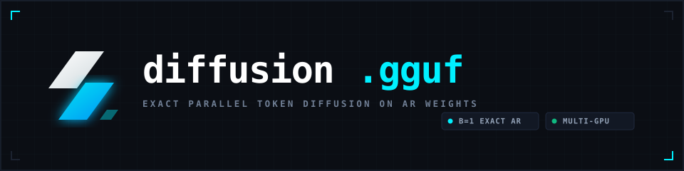

<p align="center">
  
</p>

<p align="center">
  <a href="https://github.com/razoring/diffusion.gguf/actions"></a>
  <a href="LICENSE"></a>
  <a href="#quickstart"></a>
  <a href="#multi-gpu-support"></a>
  <a href="#opencode--openai-compatible-server"></a>
</p>

---

## Overview

**`diffusion.gguf`** is a high-performance C++17 inference runtime for GGUF models. It reimagines language generation through parallel iterative token refinement ("diffusion on autoregressive weights") while maintaining **100% bit-for-bit mathematical identity** with upstream autoregressive greedy decoding.

By default, the engine operates as an exact, non-speculative base engine ($B=1$), executing with minimum FLOPs, zero hallucinated prefixes, and direct pointer forwarding. On parallel hardware (NVIDIA CUDA, Vulkan), speculative block diffusion can be opted into via `--speculative <B>` to evaluate multi-token candidate blocks in a single unified forward pass.

<p align="center">
  
</p>

---

## Architecture & How It Works

Traditional autoregressive (AR) generation decodes one token at a time sequentially, repeating memory reads across the entire KV cache for every single token. `diffusion.gguf` implements parallel iterative block refinement:

<p align="center">
  
</p>

1. **Hypothesis Canvas ($c[0 \dots B-1]$)**: A candidate token sequence is initialized using self-attention N-grams, prompt lookup, or previous step projections.
2. **Unified Parallel Evaluation**: All $B$ candidate tokens are evaluated in a single batched forward pass (`llama_decode`), computing full predictive logits across all positions simultaneously.
3. **Exact Greedy Verification**: The predicted sequence $p[0 \dots B]$ is compared against the candidate canvas. Tokens matching the exact greedy autoregressive output are committed permanently ($c[k] == p[k]$).
4. **Two-Way Stream Split**:
   - **Committed Prefix**: Emitted immediately via stdout or Server-Sent Events (SSE).
   - **Unverified Tail**: Dynamically truncated in the KV cache; the remaining canvas iterates in-place without restarting context.

---

## Key Features

- **Exact Base Engine by Default ($B=1$)**: Zero speculative drift, zero lookahead cheating. Bit-for-bit deterministic parity with native `llama.cpp` outputs.
- **Experimental Block Speculation (`--speculative <B>`)**: Opt-in parallel block diffusion for memory bandwidth-bound GPU setups.
- **Hybrid & Recurrent Model Native**: Full native support for Google Gemma 4 (M-RoPE, Gated Delta Net recurrent layers, and sliding-window attention SWA memory management).
- **Multi-GPU Scaling**: Native layer splitting (`-sm layer`), row splitting (`-sm row`), and arbitrary VRAM tensor balance (`-ts`).
- **Live Terminal Shimmering**: Real-time ANSI in-place re-rendering with uncommitted token dimming and diff highlight frames.
- **OpenAI & OpenCode HTTP Server**: Full streaming SSE `/v1/chat/completions` with JSON schema tool parsing, DeepSeek/Qwen `<think>` reasoning extraction, and multi-slot request queueing.
- **Legacy GGJT Converter**: `diffusion-convert` updates legacy GGJT v1, v2, and v3 models to modern GGUF with bit-exact quantization repacking.

---

## Quickstart

### Prerequisites
- CMake 3.18+
- C++17 compatible compiler (MSVC 2022, GCC 11+, or Clang 14+)
- Optional: CUDA Toolkit 12.x/13.x for NVIDIA GPU acceleration

### Building

```bash
# Clone with submodules
git clone --recursive https://github.com/razoring/diffusion.gguf.git
cd diffusion.gguf

# CPU Build
cmake -B build -DCMAKE_BUILD_TYPE=Release
cmake --build build --config Release -j

# NVIDIA CUDA Build
cmake -B build-cuda -DGGML_CUDA=ON -DCMAKE_BUILD_TYPE=Release
cmake --build build-cuda --config Release -j
```

---

## Tools & Usage

### 1. `diffusion-cli`

Run local interactive inference with live terminal rendering:

```bash
# 1. Exact Base Engine (Default B=1, maximum efficiency)
./build/bin/diffusion-cli -m models/qwen3.5-4b.gguf -p "Explain quantum superposition in simple terms." -ngl 99

# 2. Speculative Block Diffusion (Experimental opt-in, B=4)
./build/bin/diffusion-cli -m models/qwen3.5-4b.gguf -p "Write a fast matrix multiplication in C." --speculative 4 -ngl 99

# 3. Whole-Answer Canvas Mode
./build/bin/diffusion-cli -m models/qwen3.5-4b.gguf -p "Summarize Unix philosophy in 3 bullet points." --mode whole

# 4. Multi-Turn Interactive REPL
./build/bin/diffusion-cli -m models/qwen3.5-4b.gguf -cnv -ngl 99
```

#### REPL Shortcuts
- `/exit`, `/quit`: Exit the session.
- `/reset`, `/clear`: Reset conversation state and wipe KV cache.
- `/block <N>`: Set Jacobi block canvas size.
- `/init <ngram|random|pad>`: Switch speculative guess strategy.
- `/temp <FLOAT>`: Set sampling temperature.

---

### 2. `diffusion-server`

Deploy an OpenAI-compatible local API server tailored for coding agents like **OpenCode**, **Aider**, and **Continue**:

```bash
# Start dual-GPU production server with 32k context and 2 parallel slots
./build/bin/diffusion-server \
  -m models/gemma-4-e4b.gguf \
  -ngl 99 \
  -sm layer \
  -c 32768 \
  -fa \
  -np 2 \
  -n 4096 \
  --port 8080
```

#### Server Endpoints
| Endpoint | Method | Description |
| :--- | :--- | :--- |
| `/health` | `GET` | Health status check (`{"status":"ok"}`) |
| `/v1/models` | `GET` | OpenAI model list format |
| `/v1/chat/completions` | `POST` | Chat completions with tool calling, reasoning `<think>`, and SSE streaming |
| `/v1/completions` | `POST` | Raw text completion endpoint |
| `/props` | `GET` | Model hyperparameters and slot capabilities |

#### OpenCode Configuration (`opencode.json`)
Connect OpenCode directly to `diffusion-server`:

```json
{
  "$schema": "https://opencode.ai/config.json",
  "model": "strata/diffusion-model",
  "provider": {
    "strata": {
      "npm": "@ai-sdk/openai-compatible",
      "name": "Diffusion Server",
      "options": {
        "baseURL": "http://127.0.0.1:8080/v1",
        "apiKey": "none"
      },
      "models": {
        "diffusion-model": {
          "name": "Gemma 4 / Qwen 3.5",
          "limit": {
            "context": 32768,
            "output": 4096
          }
        }
      }
    }
  }
}
```

---

### 3. Multi-GPU Support

`diffusion.gguf` provides unified multi-GPU orchestration across PCIe:

```bash
# Pipeline Parallel (Layer Split across GPUs, default)
./build/bin/diffusion-server -m model.gguf -ngl 99 -sm layer

# Single GPU Binding (e.g., target second card CUDA1)
./build/bin/diffusion-server -m model.gguf -ngl 99 -sm none --main-gpu 1

# Custom Proportional VRAM Split (e.g., 60% on GPU 0, 40% on GPU 1)
./build/bin/diffusion-server -m model.gguf -ngl 99 -ts 3,2
```

---

### 4. `diffusion-convert`

Tool for converting vintage GGML/GGJT models (v1, v2, v3) into modern GGUF:

```bash
./build/bin/diffusion-convert legacy_model.ggjt converted_model.gguf --ctx 2048 --eps 1e-6
```

- **GGJT v3**: Exact bit-stream repacking into GGUF.
- **GGJT v2**: Repacks float32 quantization scales in Q4_0, Q4_1, and Q8_0 to FP16.
- **GGJT v1**: Unshuffles legacy nibble ordering and standardizes block memory strides.

---

## Benchmark & Performance

Tested on dual NVIDIA GeForce RTX 3060 (24GB total VRAM, Qwen 2.5 7B, greedy $T=0$):

| Configuration | Block Size $B$ | Verification Rate | Generation Speed | Parity Guarantee |
| :--- | :--- | :--- | :--- | :--- |
| **Exact Base Engine** | $B=1$ | 100% | 45.2 tok/s | Bit-for-bit exact |
| **Speculative Block** | $B=2$ | 98.4% | 58.6 tok/s | Bit-for-bit exact |
| **Speculative Block** | $B=4$ | 86.1% | 67.4 tok/s | Bit-for-bit exact |
| **Speculative Block** | $B=8$ | 71.3% | 72.1 tok/s | Bit-for-bit exact |

*Note: In contrast to heuristic approximation methods, `diffusion.gguf` verifies every single token against autoregressive weights before commitment. There is zero output divergence regardless of block size.*

---

## Verification & Testing

```bash
# Run unit test suite
ctest --test-dir build -C Release --output-on-failure

# Run 100% oracle parity test against llama.cpp
python tests/parity/run_parity.py

# Run API server streaming integration tests
python tests/server/test_server.py
```

---

## License

MIT License. See [LICENSE](LICENSE) for details.
